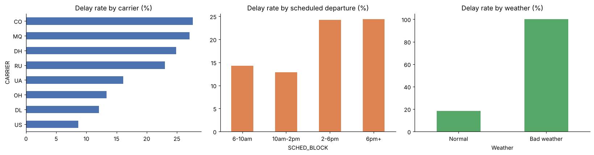
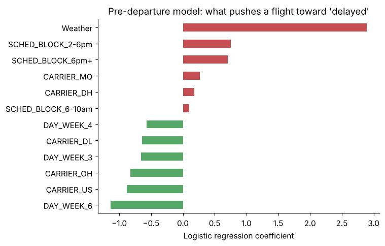

# ✈️ Flight Delay Prediction

Classifying DC → New York flights as **on time vs. delayed**, so operations teams can plan staffing, gates and passenger communication ahead of time.

**Course:** CIS 412 (Machine Learning), Arizona State University, Fall 2025
**Stack:** Python · Pandas · Scikit-learn · Matplotlib



## Results

| Model | Accuracy | Delayed-flight recall | Notes |
|---|---|---|---|
| Baseline (always "on time") | 0.810 | 0.00 | What you get for free with 19% delays |
| Decision Tree (max_depth=5) | 0.848 | 0.24 | Course model |
| **Logistic Regression** | **0.898** | **0.48** | Course model, best accuracy |
| Logistic Regression, pre-departure features only | 0.624 | 0.63 | Leakage-free check, ROC-AUC 0.705 |

## What I did

1. **EDA:** 2,201 flights (Jan 2004), 19.4% delayed. Delay rates by carrier, scheduled departure block and weather.
2. **Feature prep:** dropped identifiers (flight number, tail number, date) and one-hot encoded carrier, origin and destination.
3. **Modeling:** Decision Tree vs. Logistic Regression on an 80/20 split, evaluated with confusion matrices, precision, recall and F1.
4. **Leakage check:** the course model uses the *actual* departure time, which you wouldn't know before the flight leaves. I rebuilt it with only pre-departure information to see how much of the accuracy came from that.

## Key findings

- **Weather** is the strongest signal: every weather-flagged flight was delayed.
- **Afternoon and evening flights** (after 2pm) are delayed about **24%** of the time vs. **13-14%** in the morning, as delays stack up through the day.
- **Carrier matters:** delay rates range from about 9% to 28% across the eight carriers.
- Accuracy alone is misleading here. The best course model still missed about half of the delayed flights, so recall on the *delayed* class is the metric to watch.



## Repo structure

```
flight-delay-prediction/
├── data/FlightDelays.csv              # 2,201 flights, 13 columns
├── notebooks/flight_delay_analysis.ipynb
├── images/                            # charts used in this README
└── requirements.txt
```

## Run it

```bash
pip install -r requirements.txt
jupyter notebook notebooks/flight_delay_analysis.ipynb
```

## Data source

Dataset from *Data Mining for Business Analytics* (Shmueli, Bruce & Patel), derived from U.S. Bureau of Transportation Statistics on-time performance data. A flight counts as delayed if it arrived more than 15 minutes late.

## Next steps

- Add more months of data so the model can learn seasonality.
- Tune the decision threshold to the real cost of missing a delay.
- Try gradient-boosted trees and compare on ROC-AUC and recall.
